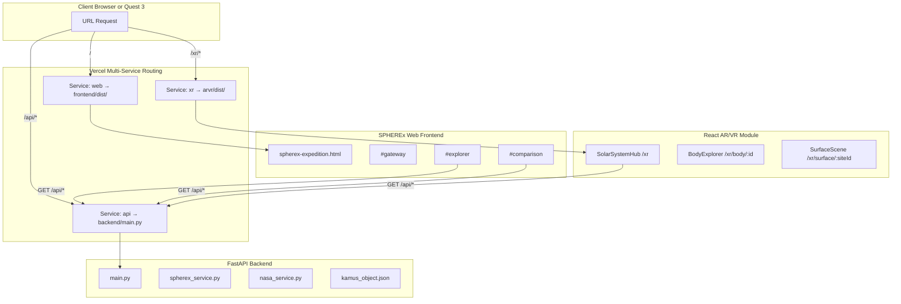

# ARCHITECTURE — SPHEREx Cosmic Expedition

> Dokumen arsitektur teknis lengkap. Konsolidasi dari INTEGRATION_ARCHITECTURE.md.  
> **Source Verified** — Berdasarkan inspeksi langsung source code di repository.  
> Status: Production-ready (Phase 5.1 Complete)

---

## 1. System Overview

Proyek ini adalah **hybrid architecture** dengan tiga layanan terpisah yang di-deploy sebagai satu Vercel Services project:

```
mainProjectSPHRX/
├── backend/        → Service "api"  — FastAPI Python
├── frontend/       → Service "web"  — Vanilla HTML/CSS/JS
└── arvr/           → Service "xr"   — React + Vite + Three.js + WebXR
```

Semua tiga module berkomunikasi melalui FastAPI backend sebagai **unified REST data provider** di bawah `/api/*`.

---

## 2. Architecture Diagram



---

## 3. Module Responsibilities

### Backend (`backend/`)
- **Tech**: Python, FastAPI, Uvicorn, Astropy, Astroquery, HTTPX, Pillow
- **Entry**: `backend/main.py`
- **Routes**: `backend/routes/*.py`
- **Services**: `backend/services/*.py`
- **Responsibilities**:
  - Query NASA IPAC IRSA via SIA2 (SPHEREx DR1 + QR3)
  - Parse FITS files dan generate PNG previews dengan AsinhStretch
  - Expose celestial object metadata (`kamus_object.json`)
  - NASA APOD via WordPress REST API
  - NASA NeoWs asteroid feed

### Frontend (`frontend/`)
- **Tech**: Vanilla HTML, CSS, JavaScript (no framework)
- **Entry**: `frontend/spherex-expedition.html`
- **Build**: `node frontend/build.mjs` → `frontend/dist/index.html`
- **Responsibilities**:
  - Single-page multi-section UI (Gateway, Explorer, Comparison)
  - Scientific observation display dengan provenance labeling
  - Mobile bottom sheet (window.ZR, max-width 767px)
  - Side-by-side, blink, dan wipe comparison

### AR/VR (`arvr/`)
- **Tech**: React 19, Vite 6, TypeScript, Three.js (r186), @react-three/fiber, @react-three/xr, Zustand
- **Entry**: `arvr/src/main.tsx`
- **Routes**: `/xr`, `/xr/body/:id`, `/xr/surface/:siteId`
- **Build**: `npm run build` → `arvr/dist/`
- **Responsibilities**:
  - Solar System hub dengan real ephemeris positions
  - Orbit views (Mars, Moon, Bennu)
  - Walkable surface sites dari NASA elevation data (8 sites)
  - SPHEREx blink comparator game
  - WebXR VR (Quest 3) dan AR (Android Chrome)

---

## 4. API Endpoints (Verified)

### SPHEREx Core
```
GET /api/spherex/observations?ra=&dec=&radius=0.05&collection=all&start_date=&end_date=&detector=
GET /api/spherex/preview?url=&shared_vmin=&shared_vmax=
GET /api/spherex/shared-normalization
GET /api/objects/{object_id}
```

### FITS & Images
```
GET /api/image/t1   — Static calibration cutout
GET /api/image/t2   — Static calibration cutout
GET /api/metadata/fits
```

### NASA External
```
GET /api/nasa/apod
GET /api/nasa/neows
```

### System
```
GET /api/status
GET /mission-control   — Interactive API test bench (HTML)
GET /docs              — Swagger UI
```

---

## 5. Vercel Services Routing

| Path Pattern | Service | Handler |
|---|---|---|
| `/api/*` | api | FastAPI backend |
| `/mission-control`, `/docs`, `/openapi.json`, `/redoc` | api | FastAPI routes |
| `/xr*` | xr | React SPA (base: `/xr/`) |
| `/*` | web | Vanilla HTML frontend |

---

## 6. Frontend Architecture

### Screen Structure (single-document)
- `#gateway` — Landing, device capability detection
- `#explorer` — Sky exploration, coordinate search, observation list
- `#comparison` — Side-by-side, blink, wipe comparator
- Cosmic Guide — Hash routing `/#/guide/:objectId`

Navigation via `showScreen(id)` yang toggle `.active` CSS class.

### Mobile Bottom Sheet (window.ZR)
- Aktif di viewport `max-width: 767px`
- States: `hidden` → `peek` → `half` → `full`
- Hanya muncul di `#explorer` screen
- Synchronized dengan `showScreen()` via `ZR.applyScreenMode()`

### API Client (`SPHERExAPI`)
- AbortController timeout protection
- In-memory TTL cache (60s status, session APOD)
- Race condition protection via request deduplication
- Provenance tracking: LIVE / CACHED / FALLBACK / ERROR

---

## 7. XR Architecture

### State Management
- `src/xr/store.ts` — App state: `bodyId`, `siteId`, `band`, `observation`, `mode`
- `src/xr/xrStore.ts` — WebXR session management

### XR Mode Detection (otomatis)
1. `immersive-vr` → Enter VR (Quest 3)
2. `immersive-ar` → Enter AR (Android Chrome/ARCore)
3. Touch + orientation sensors → Gyroscope look-around
4. Desktop fallback → OrbitControls

### Cross-Module Communication
- Frontend → XR: Custom window events (`cosmic:ask-guide`, `cosmic:back-to-source`)
- XR → Backend: Direct HTTP calls ke `/api/*`
- State handoff melalui URL parameters

### Quality Management
- `QualityGovernor.tsx` auto-step: Ultra → High → Medium → Low jika FPS < 80% dari target
- Target: 72 fps pada Meta Quest 3 Medium quality

---

## 8. Data Architecture

### SPHEREx Collections
| Collection | Records at RCW 36 | Date Range | DOI |
|---|---|---|---|
| `spherex_dr1` | 429 | Apr 2025 – May 2026 | 10.26131/IRSA678 |
| `spherex_qr3` | 70 | May 2026 – Jun 2026 | 10.26131/IRSA662 |
| Combined | 499 | 1.1-year baseline | — |

### Observation Data Model
```json
{
  "observation_id": "2026W20_2A_0176_1",
  "release": "QR3",
  "release_doi": "10.26131/IRSA662",
  "detector": "SPHEREx-D4",
  "observed_at_utc": "2026-05-15T13:49:08Z",
  "preview_url": "https://irsa.ipac.caltech.edu/ibe/cutout?...",
  "fits_url": "https://irsa.ipac.caltech.edu/ibe/data/...",
  "provenance_badge": "● LIVE QR3"
}
```

### Provenance Status Labels
- `● FACT · LIVE DR1` — Live data dari IRSA DR1
- `● FACT · LIVE QR3` — Live data dari IRSA QR3
- `● FACT · CACHED` — Client-side TTL cache
- `● FACT · LOCAL FALLBACK` — Offline fallback
- `● CANDIDATE` — Unverified detection
- `● DEMO` — Illustrative data

---

## 9. Security

| Concern | Implementation |
|---|---|
| NASA API Key | `os.getenv("NASA_API_KEY")`, fallback ke `DEMO_KEY` |
| SSRF | URL validation — HTTPS only, `irsa.ipac.caltech.edu` only |
| FITS size | 15 MB max payload limit per request |
| XR context | HTTPS required untuk WebXR immersive sessions |
| Secrets | Zero hardcoded — semua via environment variables |

---

## 10. Build & Deployment

### Production Build Steps
```bash
# 1. Frontend build
node frontend/build.mjs
# Output: frontend/dist/index.html

# 2. AR/VR build
cd arvr && npm run build
# Output: arvr/dist/ (all assets prefixed with /xr/)

# 3. Backend — no build step (FastAPI served directly)
```

### Environment Variables Required
| Variable | Service | Required | Notes |
|---|---|---|---|
| `NASA_API_KEY` | backend | Yes (production) | Fallback ke DEMO_KEY (rate-limited 30 req/hr) |

---

## 11. Known Pending Tests

| Item | Requires |
|---|---|
| Meta Quest 3 real-device testing | Owner hardware |
| Galaxy A16 AR session testing | Owner hardware |
| Vercel Services routing (live) | Production deployment |
| Service Worker HTTPS scope | Deployed HTTPS domain |

---

## 12. Phase History Summary

| Phase | Topic | Tests Passed |
|---|---|---|
| 1 | Security & APOD Migration | 9 |
| 2 | Vercel Services & Build | Build PASS |
| 3 | Mobile Frontend Polish | 257 |
| 4A | API Contract Audit | — (audit only) |
| 4B | Live API Integration | 43 |
| 4B.1 | Scientific Data Validation | 63 |
| 4C | DR1 Compatibility Audit | — (audit only) |
| 5 | Unified DR1 + QR3 | 120 |
| 5.1 | Scientific Calibration Hardening | 127 |

Full reports tersedia di `docs/archive/`.

