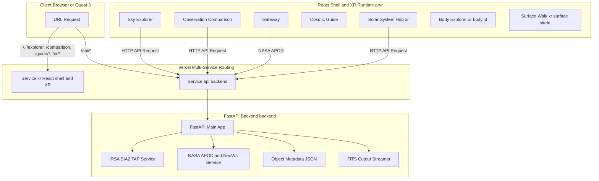

# SPHEREX COSMIC EXPEDITION — CROSS-MODULE INTEGRATION ARCHITECTURE
## FINAL IMPLEMENTATION SPECIFICATION — SOURCE VERIFIED, DEPLOYMENT PENDING

## 1. Executive Summary
This document establishes the finalized, production-ready integration architecture for the **NASA Space Apps Challenge 2026 Cosmic Expedition** monorepo (`mainProjectSPHRX/`). By synthesizing audit findings across Backend FastAPI, the SPHEREx Vanilla HTML/CSS/JS frontend prototype (`spherex-expedition.html`), and the React 19 / Three.js / WebXR application (`arvr/`), this specification resolves routing, API limitations, Vercel Services multi-service deployment, Vite base paths, Service Worker scoping, and build artifact sanitization.

---

## 2. Integrated Architecture: Single React Shell with Isolated Immersive Runtime

- **Core Rationale**: `frontend/spherex-expedition.html` remains the visual and interaction reference. Gateway, Explorer, Comparison, Cosmic Guide, and the existing XR experiences are rendered by the React/Vite application in `arvr/` and managed by one `BrowserRouter`. FastAPI remains a separate service under `/api/*`.
- **Runtime Boundary**: The React shell serves `/`, `/explorer`, `/comparison`, `/guide/:objectId`, and `/xr/*`; the XR scenes and offline runtime remain in their existing module. No iframe or second frontend deployment is used for application navigation.

---

## 3. Validated Architecture Diagram (Mermaid)

---

## 4. Module Responsibility Matrix

| Module | Core Responsibilities | Primary Technologies |
| :--- | :--- | :--- |
| **Backend (`backend/`)** | NASA API integration (WordPress APOD endpoint migration & NeoWs), IRSA SIA2 observation queries, celestial object metadata (`kamus_object.json`), FITS metadata parsing, cutout image generation (`/api/image/t1`, `/api/image/t2`). | FastAPI, Astropy, Astroquery, Httpx, Uvicorn |
| **Frontend reference (`frontend/`)** | Design and behavior source for Gateway, Sky Explorer, Observation Comparison, and Cosmic Guide. | HTML5, CSS, JavaScript prototype |
| **Application shell and AR/VR (`arvr/`)** | Single React Router host for the migrated 2D screens and the existing desktop, mobile, WebXR, and surface experiences. | React 19, Vite 6, Three.js, R3F, Drei, @react-three/xr, Zustand |

---

## 5. Verified API Integration Matrix & Critical APOD Migration

| Endpoint | Calling Module | Parameters | Response Structure / Behavior | Actual Error / Fallback State |
| :--- | :--- | :--- | :--- | :--- |
| `GET /api/status` | Frontend / AR/VR | None | `{ status, data_source, engine, capabilities, message }` | Returns operational JSON status |
| `GET /api/spherex/observations` | React Explorer and Comparison | `ra`, `dec`, `radius`, `collection`, `start_date`, `end_date`, `detector` | `{ query, source, total_results, observations: [...] }`, including `observation_id`, `observed_at_utc`, `preview_url`, and `fits_url` | Search errors and empty results are displayed; no observation metadata is fabricated |
| `GET /api/objects/{object_id}` | Frontend / AR/VR | `object_id` (path, e.g., `mars`, `halley`, `jupiter`) | Dictionary properties from `kamus_object.json` | Returns 404 if object ID not found |
| `GET /api/image/t1` | Frontend (Comparison) | None | Binary PNG stream (`FileResponse`). *Note: serves hasil_gambar.png* | Returns 404 if image not generated yet |
| `GET /api/image/t2` | Frontend (Comparison) | None | Binary PNG stream (`FileResponse`). *Note: serves hasil_gambar_2.png (currently identical)* | Returns 404 if image not generated yet |
| `GET /api/metadata/fits` | Frontend (Explorer) | None | FITS Header dictionary (`telescope`, `observation_date`, `right_ascension`, `declination`) | Returns 404 if physical `.fits` file is missing on server |
| `GET /api/nasa/apod` | Frontend / Gateway | None | Normalized APOD JSON (`source`, `title`, `date`, `explanation`, `image_url`, etc.) | Returns `DUMMY_APOD` on upstream NASA timeout |
| `GET /api/nasa/neows` | Frontend / Gateway | None | Normalized NeoWs JSON (`source`, `total_asteroids`, `hazardous_asteroids_count`, `asteroids`) | Returns HTTP 502 on upstream failure |

*Urgent NASA APOD Migration*: NASA deprecated the legacy APOD endpoint and migrated APOD to the WordPress REST API endpoint:
`https://science.nasa.gov/wp-json/wp/v2/apod-basic`
(scheduled for permanent legacy sunset on December 1, 2026). `backend/services/nasa_service.py` must be updated to target this new endpoint.

---

## 6. Verified Route Structure & Root Handling

- **Root Routing & `/`**:
  - `/`, `/explorer`, `/comparison`, `/guide`, and `/guide/:objectId` -> React/Vite application in `arvr/`.
  - `/mission-control` -> FastAPI SaaS documentation and test bench dashboard.
  - `/docs`, `/openapi.json`, `/redoc` -> Standard FastAPI OpenAPI documentation routes.
- **AR/VR SPA Routes (`/xr/*`)**:
  - `/xr` -> Solar System Hub
  - `/xr/body/:id` -> Body Explorer
  - `/xr/surface/:siteId` -> Walkable Surface
  - Managed by the same React Router (`BrowserRouter`); query parameters such as `target`, `obs`, and `band` carry available context.

---

## 7. Inter-Module Communication Contract

- **Window CustomEvents (`window.dispatchEvent`)**:
  - `cosmic:ask-guide`: Emitted by AR/VR (`arvr/src/xr/events.ts`) and consumed by host listeners with payload `{ body, hotspotId, guidePrompt }`.
  - `cosmic:back-to-source`: Emitted by AR/VR to signal return to source imagery.
- **Context Navigation**: State synchronization between the 2D screens and XR uses URL query parameters such as `target`, `obs`, and `band`; `RouteSync.tsx` transfers XR observation and band values into the shared store.

---

## 8. Corrected Data Model & Scientific Honesty

- **Identifier Harmonization**:
  - Backend `kamus_object.json`: `mars`, `halley`, `jupiter`.
  - AR/VR `content/bodies/*.json`: `mars`, `moon`, `bennu`.
  - Catalog target: `rcw-36`. Candidate and demo markers are illustrative only and do not have fabricated coordinates or observations.
- **Taxonomy**: Distinct schema objects for *Solar System Bodies* (planets/moons), *Catalog Observation Targets* (nebulae, star-forming regions), and *Discrete Epoch Observations* (T1 vs. T2).
- **Scientific Honesty Guardrails**: Every data record explicitly declares its provenance status: **Fact**, **Illustration**, **Candidate (unconfirmed)**, or **Unverified**.

---

## 9. Vercel Services Routing & Build Output

- **Application Services**: The root project exposes the React/Vite `xr` application service and the FastAPI `api` service. The standalone `web` service is no longer part of the application routing.
- **Application Service Routing & Asset Handling**:
  - Under Vercel Services, the `xr` service receives application routes as well as `/xr/*`. Vite remains configured with `base: '/xr/'` so asset bundles and service-worker resources preserve their established `/xr/` URLs.
  - React Router deep links (`/xr/body/mars`) hit the `xr` service rewrite, which serves `dist/index.html`, allowing client-side hydration to take over.
  - The Vite development server proxies `/api/*` to `http://127.0.0.1:8000`; root Vercel rewrites continue to send `/api/*` to FastAPI.

---

## 10. Security Requirements
- **NASA API Key**: Enforced via backend environment variables (`NASA_API_KEY`). Public fallback keys removed.
- **CORS**: FastAPI CORS middleware configured with explicit origins for local development and same-origin production routing.
- **Secure Contexts**: HTTPS required for WebXR immersive sessions and mobile device orientation sensors.

---

## 11. Phased Implementation Roadmap

1. **Phase 1: Security & APOD Migration** — Remove public fallback API keys, enforce `os.getenv()`, and update `nasa_service.py` to target the official NASA WordPress APOD endpoint (`https://science.nasa.gov/wp-json/wp/v2/apod-basic`).
2. **Phase 2: Vercel Services & Build Routing** — Configure the React/Vite and FastAPI services, preserve `base: '/xr/'` in production, and scope the AR/VR Service Worker to `/xr/`.
3. **Phase 3: Mobile Frontend Polish** — Implement `window.ZR` bottom sheet lifecycle and verify two-column capabilities grid at `<= 680px`.
4. **Phase 4: API Client Wiring** — The migrated React screens use `/api/objects/{object_id}`, `/api/spherex/observations`, and `/api/nasa/apod`; empty results and failures remain explicit.
5. **Phase 5: AR/VR Event Bridge & Deep-Linking** — The shared React router carries available `target`, `obs`, and `band` context through the XR URL; `RouteSync.tsx` synchronizes observation and band with the XR store.
6. **Phase 6: Verification & QA** — Production build, local route/API checks, and the XR emulator smoke test are verified. Real-device cross-device compliance and deployment remain pending.

---

## 13. Verification Status Matrix

| Verification Category | Status | Details |
| :--- | :--- | :--- |
| **Verified by Source Inspection** | Verified | Architecture maps, API routes, Vite configs, Service Worker scoping, and routing constraints. |
| **Verified by Local Execution** | Verified | `npm run build`, direct route/refresh checks, local FastAPI object/observation/APOD calls, and `npm run smoke:xr` against the production preview passed. |
| **Verified by Actual Deployment** | Not yet tested | Requires production deployment to Vercel Services. |
| **Not Yet Tested** | Pending | Real-device Meta Quest 3 FPS measurements (72 FPS target) and mobile AR hit-test validation. |
