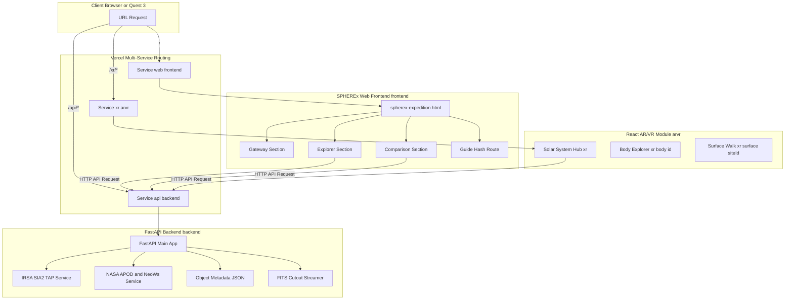

# SPHEREX COSMIC EXPEDITION — CROSS-MODULE INTEGRATION ARCHITECTURE
## FINAL IMPLEMENTATION SPECIFICATION — SOURCE VERIFIED, DEPLOYMENT PENDING

## 1. Executive Summary
This document establishes the finalized, production-ready integration architecture for the **NASA Space Apps Challenge 2026 Cosmic Expedition** monorepo (`mainProjectSPHRX/`). By synthesizing audit findings across Backend FastAPI, the SPHEREx Vanilla HTML/CSS/JS frontend prototype (`spherex-expedition.html`), and the React 19 / Three.js / WebXR application (`arvr/`), this specification resolves routing, API limitations, Vercel Services multi-service deployment, Vite base paths, Service Worker scoping, and build artifact sanitization.

---

## 2. Recommended Architecture: Hybrid Shell with Isolated Immersive Runtime (Approach C)

We select **Approach C (Hybrid Architecture with Dedicated Shell & Isolated Immersive Runtime)**:
- **Core Rationale**: The SPHEREx HTML prototype (`frontend/spherex-expedition.html`) is structured as a single-document multi-section application (`showScreen()`) where Gateway, Explorer, and Comparison are internal DOM sections, and Cosmic Guide uses hash routing (`/#/guide/:objectId`). The React AR/VR module (`arvr/`) runs as an independent React SPA managed by `BrowserRouter` using explicit `/xr` paths in `RouteSync.tsx`. Both modules consume the FastAPI backend (`backend/`) as their unified REST data provider under `/api/*`.

---

## 3. Validated Architecture Diagram (Mermaid)

---

## 4. Module Responsibility Matrix

| Module | Core Responsibilities | Primary Technologies |
| :--- | :--- | :--- |
| **Backend (`backend/`)** | NASA API integration (WordPress APOD endpoint migration & NeoWs), IRSA SIA2 observation queries, celestial object metadata (`kamus_object.json`), FITS metadata parsing, cutout image generation (`/api/image/t1`, `/api/image/t2`). | FastAPI, Astropy, Astroquery, Httpx, Uvicorn |
| **Frontend (`frontend/`)** | Single-page multi-section UI (Gateway, Sky Explorer, Observation Comparison), capability detection, bottom-sheet lifecycle (`window.ZR`), and hash-routed Cosmic Guide assistant. | HTML5, Modern CSS (Design Tokens), Vanilla JS (ES Modules) |
| **AR/VR (`arvr/`)** | Desktop 3D Solar System orbit hub, mobile gyroscope look-around, WebXR AR (tabletop hit-test passthrough), WebXR VR (Quest controllers, teleportation, hand tracking, wrist menu), walkable planetary surface terrains. | React 19, Vite 6, Three.js, R3F, Drei, @react-three/xr, Zustand |

---

## 5. Verified API Integration Matrix & Critical APOD Migration

| Endpoint | Calling Module | Parameters | Response Structure / Behavior | Actual Error / Fallback State |
| :--- | :--- | :--- | :--- | :--- |
| `GET /api/status` | Frontend / AR/VR | None | `{ status, data_source, engine, capabilities, message }` | Returns operational JSON status |
| `GET /api/spherex/observations` | Frontend (Explorer) | `ra`, `dec`, `radius`, `collection`, `start_date`, `end_date`, `detector` | `{ query, source, total_results, observations: [...] }` | Returns 504 on SIA2 timeout; frontend falls back to static samples |
| `GET /api/objects/{object_id}` | Frontend / AR/VR | `object_id` (path, e.g., `mars`, `halley`, `jupiter`) | Dictionary properties from `kamus_object.json` | Returns 404 if object ID not found |
| `GET /api/image/t1` | Frontend (Comparison) | None | Binary PNG stream (`FileResponse`). *Note: serves hasil_gambar.png* | Returns 404 if image not generated yet |
| `GET /api/image/t2` | Frontend (Comparison) | None | Binary PNG stream (`FileResponse`). *Note: serves hasil_gambar_2.png (currently identical)* | Returns 404 if image not generated yet |
| `GET /api/metadata/fits` | Frontend (Explorer) | None | FITS Header dictionary (`telescope`, `observation_date`, `right_ascension`, `declination`) | Returns 404 if physical `.fits` file is missing on server |
| `GET /api/nasa/apod` | Frontend / Gateway | None | Normalized APOD JSON (`source`, `title`, `date`, `explanation`, `image_url`, etc.) | Returns `DUMMY_APOD` on upstream NASA timeout |
| `GET /api/nasa/neows` | Frontend / Gateway | None | Normalized NeoWs JSON (`source`, `total_asteroids`, `hazardous_asteroids_count`, `asteroids`) | Returns HTTP 502 on upstream failure |

*Urgent NASA APOD Migration*: NASA deprecated the legacy APOD endpoint and migrated APOD to the WordPress REST API endpoint:
`https://science.nasa.gov/wp-json/wp/v2/apod-basic`
(scheduled for permanent legacy sunset on December 1, 2026). `backend/services/nasa_service.py` must be updated to target this new endpoint.

---

## 6. Verified Route Structure & Root Handling

- **Root Routing & `/`**:
  - `/` -> Serves `frontend/spherex-expedition.html` (HTML shell).
  - `/mission-control` -> FastAPI SaaS documentation and test bench dashboard.
  - `/docs`, `/openapi.json`, `/redoc` -> Standard FastAPI OpenAPI documentation routes.
- **Frontend SPA Sections**:
  - Managed internally via `spherex-expedition.html` sections (`#gateway`, `#explorer`, `#comparison`) and hash routing (`/#/guide/:objectId`). `/explorer` and `/comparison` are not standalone pathname routes.
- **AR/VR SPA Routes (`/xr/*`)**:
  - `/xr` -> Solar System Hub
  - `/xr/body/:id` -> Body Explorer
  - `/xr/surface/:siteId` -> Walkable Surface
  - Managed by React Router (`BrowserRouter` with explicit `/xr` paths in `RouteSync.tsx`).

---

## 7. Inter-Module Communication Contract

- **Window CustomEvents (`window.dispatchEvent`)**:
  - `cosmic:ask-guide`: Emitted by AR/VR (`arvr/src/xr/events.ts`) and consumed by host listeners with payload `{ body, hotspotId, guidePrompt }`.
  - `cosmic:back-to-source`: Emitted by AR/VR to signal return to source imagery.
- **Cross-Origin/Context Navigation**: Since AR/VR runs under `/xr/*`, state synchronization between the main frontend and the XR runtime is handled via URL query parameters, hash state, or session storage rather than live DOM event listeners.

---

## 8. Corrected Data Model & Scientific Honesty

- **Identifier Harmonization**:
  - Backend `kamus_object.json`: `mars`, `halley`, `jupiter`.
  - AR/VR `content/bodies/*.json`: `mars`, `moon`, `bennu`.
  - Frontend static targets: `rcw-36`, `candidate`, `demo-tile-01`, `vela-ridge`.
- **Taxonomy**: Distinct schema objects for *Solar System Bodies* (planets/moons), *Catalog Observation Targets* (nebulae, star-forming regions), and *Discrete Epoch Observations* (T1 vs. T2).
- **Scientific Honesty Guardrails**: Every data record explicitly declares its provenance status: **Fact**, **Illustration**, **Candidate (unconfirmed)**, or **Unverified**.

---

## 9. Vercel Services Routing & Build Output Sanitization

- **Build Output Sanitization Risk**: Pointing `outputDirectory` directly to `frontend/` exposes internal design files (`DESIGN.md`, markdown plans, screenshots).
- **Recommended Solution**: Introduce a lightweight pre-build step (or build script) that copies only production assets (`spherex-expedition.html`, assets, and necessary runtime scripts) into a clean `frontend/dist/` directory, which then serves as the `outputDirectory` for the `web` service.
- **XR Service Routing & Asset Handling**:
  - Under Vercel Services, the `xr` service receives requests matching `/xr/*`. Because the request path is received as-is by the service, Vite must be configured with `base: '/xr/'` so asset bundles reference `/xr/assets/...`.
  - React Router deep links (`/xr/body/mars`) hit the `xr` service rewrite, which serves `dist/index.html`, allowing client-side hydration to take over.

---

## 10. Security Requirements
- **NASA API Key**: Enforced via backend environment variables (`NASA_API_KEY`). Public fallback keys removed.
- **CORS**: FastAPI CORS middleware configured with explicit origins for local development and same-origin production routing.
- **Secure Contexts**: HTTPS required for WebXR immersive sessions and mobile device orientation sensors.

---

## 11. Phased Implementation Roadmap

1. **Phase 1: Security & APOD Migration** — Remove public fallback API keys, enforce `os.getenv()`, and update `nasa_service.py` to target the official NASA WordPress APOD endpoint (`https://science.nasa.gov/wp-json/wp/v2/apod-basic`).
2. **Phase 2: Vercel Services & Build Sanitization** — Configure root `vercel.json` with three services (`web`, `api`, `xr`), set up a clean `frontend/dist` build output, set `base: '/xr/'` in Vite, and scope the AR/VR Service Worker to `/xr/`.
3. **Phase 3: Mobile Frontend Polish** — Implement `window.ZR` bottom sheet lifecycle and verify two-column capabilities grid at `<= 680px`.
4. **Phase 4: API Client Wiring** — Connect frontend fetch handlers to live FastAPI endpoints (`/api/spherex/observations`, `/api/objects/{object_id}`, `/api/nasa/apod`).
5. **Phase 5: AR/VR Event Bridge & Deep-Linking** — Ensure `cosmic:ask-guide` and URL parameters synchronize correctly between `/` and `/xr/*`.
6. **Phase 6: Verification & QA** — Execute build checks (`npm run build`), verify Playwright smoke tests (`smoke-xr.mjs`), and confirm cross-device compliance.

---

## 13. Verification Status Matrix

| Verification Category | Status | Details |
| :--- | :--- | :--- |
| **Verified by Source Inspection** | Verified | Architecture maps, API routes, Vite configs, Service Worker scoping, and routing constraints. |
| **Verified by Local Execution** | Not yet tested | Requires running local test suites (`npm run build`, `smoke:xr`). |
| **Verified by Actual Deployment** | Not yet tested | Requires production deployment to Vercel Services. |
| **Not Yet Tested** | Pending | Real-device Meta Quest 3 FPS measurements (72 FPS target) and mobile AR hit-test validation. |
