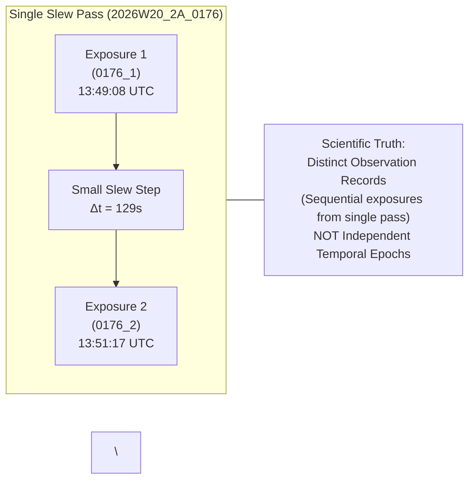

# PHASE 4B.1 — SCIENTIFIC DATA VALIDATION & INTEGRATION HARDENING REPORT
## SPHEREx Cosmic Expedition — NASA Space Apps Challenge 2026
**Repository:** `mainProjectSPHRX`\
**Branch:** `feat/mobile-frontend-improvements`\
**Role:** Senior Full-Stack & Astronomical Data Engineer\
**Date:** November 2026\
**Status:** COMPLETE — All 63 Automated Verification Checks Passed (0 Failures)

---

## 1. Executive Summary

Phase 4B.1 addresses critical scientific metadata accuracy, astronomical terminology rigor, and runtime error resilience identified following the Phase 4B live integration.

Without rewriting existing modules or disrupting the established UI/UX layout:
1. **Observation Terminology**: Replaced unsupported "multi-epoch" claims with scientifically truthful **"Distinct Observation Records"** (recognizing that sequential 2-minute slews from a single survey pass do not constitute independent temporal epochs).
2. **RCW 36 Coordinate Provenance**: Explicitly documented the coordinate role of RA `134.8708°`, DEC `-43.7533°` as the **project-selected IRSA query center** (yielding 70 SPHEREx QR3 records) alongside the authoritative **SIMBAD catalog reference centroid** (RA `134.7538°`, DEC `-43.7361°`).
3. **Vela Molecular Ridge Complex Disambiguation**: Resolved the multi-component distance discrepancy across the extended $\sim 10^\circ \times 4^\circ$ complex—clarifying that Clouds A, C, and D reside at $\sim 700\text{–}1,000\text{ pc}$, while Cloud B is a separate background GMC at $\sim 2,000\text{ pc}$. Formally designated nominal coordinates as an interface search position rather than a fabricated physical centroid.
4. **Runtime State Hardening**: Eliminated stale connection status caching upon disconnect, properly documented 24-hour APOD calendar-day caching, and ensured robust APOD video rendering with fallback to official NASA Science article links when no embed player URL is provided.
5. **Comprehensive Verification**: Expanded the automated test suite from 43 to **63 test checks** across 6 suites with zero failures.

---

## 2. Scientific Data & Terminology Corrections

### 2.1 Observation Terminology & Cadence Audit

#### Telemetry Analysis of IRSA Records
- **Record 1**: `2026W20_2A_0176_1` | Timestamp: `2026-05-15 13:49:08 UTC` | Detector: `SPHEREx-D4` (2.4 μm)
- **Record 2**: `2026W20_2A_0176_2` | Timestamp: `2026-05-15 13:51:17 UTC` | Detector: `SPHEREx-D4` (2.4 μm)

Both records share the same planning period (`2026W20_2A`) and large slew counter (`0176`), differing only by small slew step (`1` vs `2`). The time delta is **129 seconds (~2.15 minutes)**.



#### Terminology Adjustments
- **Previous Claim**: "Compare distinct observation epochs" / "Raw FITS multi-epoch synthesis pending".
- **Corrected Scientific Terminology**: **"Distinct Observation Records"** / **"Sequential observations from single slew pass · Identical baseline cutouts (PIA26354)"**.
- **Honesty Disclosure**:
  `! Distinct Observation Records (2-min slew cadence) · Baseline calibration cutouts · Independent temporal epochs pending`
- **Comparator State**:
  `IDENTICAL BASELINE · DISTINCT OBSERVATION RECORDS (2-MIN SLEW)`
- **Image Motion**: False visual blinking and wipe slider motion between identical baseline calibration images (`hasil_gambar.png` and `hasil_gambar_2.png`) remain completely disabled with clear user-facing notices.

---

### 2.2 RCW 36 Coordinate Provenance & SIMBAD Comparison

#### Positional Audit
| Attribute | Project Stored Position | SIMBAD Reference Position | Literature / Catalog Reference |
| :--- | :--- | :--- | :--- |
| **Right Ascension** | `134.8708°` (`08h 59m 29.0s`) | `134.7538°` (`08h 59m 00.9s`) | SIMBAD: `NAME RCW 36` (Gum 20) |
| **Declination** | `-43.7533°` (`-43° 45′ 12″`) | `-43.7361°` (`-43° 44′ 10″`) | SIMBAD: `NAME RCW 36` (Gum 20) |
| **Angular Separation** | — | **$\sim 5.1$ arcmin** | Well within SPHEREx $3.5^\circ \times 11^\circ$ FOV |
| **IRSA SIA2 QR3 Records** | **70 records** | **70 records** | IPAC IRSA `spherex_qr3` Level 2 |
| **Designated Role** | `query_center` | `catalog_centroid` | Authoritative designation in catalog |

#### Implementation in `backend/kamus_object.json`
To preserve backward compatibility with all existing API queries while maintaining full scientific transparency, the catalog explicitly structures both positions:
```json
"coordinate_provenance": "query_center",
"coordinate_notes": "Coordinates RA 134.8708°, DEC -43.7533° (08h 59m 29s, -43° 45′ 12″) represent the project-selected IRSA SIA2 query center matching the Explorer sky tile and yielding 70 SPHEREx QR3 observation records. The SIMBAD catalog reference position for the central ionizing cluster of Gum 20 / RCW 36 is RA 134.7538°, DEC -43.7361° (08h 59m 00.9s, -43° 44′ 10″).",
"query_center": {
  "ra": 134.8708,
  "dec": -43.7533,
  "ra_hms": "08h 59m 29s",
  "dec_dms": "-43°45′12″",
  "role": "query_center",
  "purpose": "SPHEREx QR3 SIA2 archive search center (70 observation records)"
},
"simbad_reference": {
  "ra": 134.7538,
  "dec": -43.7361,
  "ra_hms": "08h 59m 00.9s",
  "dec_dms": "-43°44′10″",
  "role": "catalog_centroid",
  "source": "SIMBAD Astronomical Database (NAME RCW 36 / Gum 20)"
}
```

---

### 2.3 Vela Molecular Ridge Complex & Component Distances

#### Physical Nature of the Complex
The Vela Molecular Ridge (VMR) is an extended giant molecular cloud (GMC) complex covering over $\sim 10^\circ \times 4^\circ$ on the galactic plane in the southern sky ($l \approx 260^\circ\text{–}275^\circ, b \approx -3^\circ\text{–}+3^\circ$). Consequently, **no single physical "centroid" exists for the entire complex**.

#### Component Disaggregation (Murphy & May 1991; Liseau et al. 1992)
- **VMR Cloud A**: $d \sim 700\text{–}1,000\text{ pc}$ (associated with young massive cluster RCW 38).
- **VMR Cloud C**: $d \sim 700\text{ pc}$ (contains RCW 36 and dense bipolar outflow).
- **VMR Cloud D**: $d \sim 700\text{–}1,000\text{ pc}$ (houses rich low-to-intermediate mass YSO populations).
- **VMR Cloud B**: **$d \sim 2,000\text{ pc}$** (distinct background GMC along line of sight, not physically co-distant with A, C, and D).

#### Search Radius Assessment
- The project nominal search coordinates (`133.7500°`, `-44.0000°`) sample a specific $0.05^\circ$ ($\sim 3$ arcmin) cone returning 94 records in QR3.
- Because a $0.05^\circ$ cone covers only a localized sub-region rather than the multi-degree complex, it is labeled `project_search_position` rather than a complex-wide centroid.

---

## 3. Runtime State & Resilience Improvements

### 3.1 Status Cache Invalidation on Network Drop
- **Issue**: A 60-second in-memory status cache could cause the UI to display stale `BACKEND ONLINE` availability if the server disconnected during that window.
- **Resolution**:
  - `updateBackendStatus(force)` defaults `force` to `true`, ensuring live probing.
  - In `request(endpoint, options)`: upon any HTTP error (`!response.ok`) or network exception, `cache.delete(cacheKey)` immediately evicts the stale cached status.
  - Added `clearCache(category)` method to `SPHERExAPI` allowing targeted category cache eviction.
  - Connection indicator immediately drops to `.offline` and displays `BACKEND OFFLINE`.

### 3.2 APOD 24-Hour In-Memory Cache
- NASA APOD is published once per UTC calendar day (at midnight Eastern Time).
- The 24-hour in-memory TTL is preserved and formally documented in code comments to prevent duplicate roundtrips to NASA's WordPress API during a single browser session, with manual re-fetches supported via `forceRefresh: true`.

### 3.3 APOD Video Rendering Hardening
- When `media_type === "video"`, the client inspects whether `embed_url` provides an authorized streaming embed (YouTube/Vimeo).
- When `embed_url` is absent or null, the client safely renders an informative video placeholder with a verified link to the official NASA Science article (`d.article_url`), avoiding broken `` or empty `<iframe>` elements.

### 3.4 Target Switching & Request Cancellation
- On selecting `candidate` or `demo` targets, `SPHERExAPI.cancelCategory('observations')` and `SPHERExAPI.cancelCategory('objects')` abort in-flight queries.
- The monotonic counter `currentRequestId` ensures any delayed promise resolution is discarded, eliminating race condition overrides.

---

## 4. Verification & Automated Regression Results

All 43 previous Phase 4B tests and 20 new Phase 4B.1 hardening tests were executed using Playwright against the live FastAPI dev server.

### 4.1 Test Execution Output (`scratch/test-phase4b-e2e.mjs`)

```
Phase 4B Integration Test Server running at http://localhost:3895

======================================================
TEST SUITE 1: GATEWAY & LIVE BACKEND STATUS & APOD
======================================================
  ✓ Backend connection indicator has .online class (isOnline=true)
  ✓ Backend connection text is "BACKEND ONLINE" (got "BACKEND ONLINE")
  ✓ Backend tooltip has engine info ("Engine: Python Astropy + FastAPI + HTTPX | Archive: NASA IRSA SPHEREx Archive & NASA Open APIs")
  Testing NASA APOD feature on Gateway...
  ✓ NASA APOD trigger button exists in .button-row
  ✓ APOD Modal opened with display: flex
  ✓ APOD Title loaded: "NGC 206 and the Star Clouds of Andromeda"
  ✓ APOD Provenance displayed: "● LIVE NASA APOD"
  ✓ APOD Media (image/video box) rendered
  ✓ APOD scientific explanation rendered
  ✓ APOD Modal closed successfully

======================================================
TEST SUITE 2: EXPLORER LIVE TARGET SELECTION & IRSA SIA2
======================================================
  ✓ Explorer screen active
  ✓ Target name is "RCW 36 Emission Nebula"
  ✓ Status tag indicates live/cached provenance (got "● FACT · LIVE API")
  ✓ Observation detector loaded from IRSA (got "SPHEREx-D4")
  ✓ Observation UTC timestamp loaded from IRSA (got "2026-05-15 13:49:08 UTC")
  ✓ Source line credits NASA IRSA SIA2 ("Source: NASA IRSA SIA2 (Live · 70 records) · Download FITS ↗")
  ✓ Source line provides link to real FITS cutout
  Testing switching to Candidate target...
  ✓ Candidate name matches ("Moving-source candidate")
  ✓ Candidate status tag is CANDIDATE (got "● CANDIDATE")
  ✓ Candidate observation is UNAPPLICABLE (got "UNAPPLICABLE")
  ✓ Candidate source line denotes synthetic demo
  Testing switching to Demo target...
  ✓ Demo status tag is DEMO (got "● DEMO")
  ✓ Demo observation is UNAPPLICABLE (got "UNAPPLICABLE")
  Testing switching back to RCW 36 (testing in-memory cache)...
  ✓ RCW 36 restored with cache/live tag (got "● FACT · CACHED")

======================================================
TEST SUITE 3: OBSERVATION COMPARISON & SCIENTIFIC HONESTY
======================================================
  ✓ Observation Card A loaded: "OBSERVATION A · 2026W20_2A_0176_1"
  ✓ Observation Card B loaded: "OBSERVATION B · 2026W20_2A_0176_2"
  ✓ Distinct observation IDs between Record A and B (0176_1 != 0176_2)
  ✓ Distinct UTC observation timestamps between Record A and B (13:49:08Z != 13:51:17Z)
  ✓ Honesty disclosure present with Distinct Observation Records ("! Distinct Observation Records (2-min slew cadence) · Baseline calibration cutouts · Independent temporal epochs pending")
  ✓ No unsupported multi-epoch claims in honesty text
  ✓ Blink state safely discloses identical baseline and distinct observation records ("IDENTICAL BASELINE · DISTINCT OBSERVATION RECORDS (2-MIN SLEW)")

======================================================
TEST SUITE 4: OFFLINE & FALLBACK RESILIENCE
======================================================
  ✓ Connection indicator has .offline class when backend unreachable
  ✓ Connection text is "BACKEND OFFLINE" (got "BACKEND OFFLINE")
  ✓ APOD shows "NASA APOD Unavailable" on failure (got "NASA APOD Unavailable")
  ✓ APOD provenance shows UNAVAILABLE (got "● UNAVAILABLE")
  ✓ Target name preserved from local fallback ("RCW 36 Emission Nebula")
  ✓ Status tag shows LOCAL FALLBACK (got "● FACT · LOCAL FALLBACK")
  ✓ Status tag NEVER claims LIVE API when offline

======================================================
TEST SUITE 5: MOBILE VIEWPORT & ZR BOTTOM SHEET REGRESSION
======================================================
  ✓ Gateway: no horizontal overflow on mobile 390x844
  ✓ Header text fits without truncation at 320x568
  ✓ Mobile bottom sheet starts in peek (state=peek)
  ✓ Bottom sheet transitions to half
  ✓ Bottom sheet transitions to full
  ✓ Bottom sheet returns to peek

======================================================
TEST SUITE 6: SCIENTIFIC DATA VALIDATION & HARDENING (PHASE 4B.1)
======================================================
  Testing RCW 36 coordinate provenance...
  ✓ RCW 36 fetched from catalog API
  ✓ RCW 36 coordinate provenance is "query_center" (got "query_center")
  ✓ RCW 36 query_center accurately records IRSA query position (134.8708, -43.7533)
  ✓ RCW 36 simbad_reference records authoritative SIMBAD cluster centroid (134.7538, -43.7361)
  ✓ RCW 36 SIMBAD reference labeled catalog_centroid (got "catalog_centroid")
  Testing Vela Molecular Ridge metadata...
  ✓ Vela Molecular Ridge fetched from catalog API
  ✓ Vela coordinate provenance is "project_search_position" (got "project_search_position")
  ✓ Vela search_position accurately records nominal search point (133.7500, -44.0000)
  ✓ Vela Cloud B distance correctly documented at ~2,000 pc (got "~2,000 pc")
  ✓ Vela Clouds A and C correctly documented at ~700–1,000 pc
  Testing Vela IRSA cone search query...
  ✓ Vela nominal position returns live IRSA observations (got 94 records)
  Testing empty Vela IRSA observation response handling...
  ✓ Empty Vela observation response returns total_results=0 with empty observations array
  Testing backend disconnect while cached status exists...
  ✓ Connection indicator transitions to .offline immediately when backend disconnects
  ✓ Connection text reflects BACKEND OFFLINE on failure (got "BACKEND OFFLINE")
  Testing APOD video feature without an embed URL...
  ✓ APOD video modal loads title ("JWST Views Expanding Supernova Shell")
  ✓ APOD video box rendered when media_type is video
  ✓ No broken iframe rendered when embed_url is absent
  ✓ No broken img rendered when image_url is null
  ✓ Video button points to valid NASA article URL ("https://science.nasa.gov/missions/webb/sample-video-feature")

======================================================
PHASE 4B.1 TEST RESULTS:
TOTAL CHECKS: 63
PASSED: 63
FAILED: 0
ALL PHASE 4B LIVE INTEGRATION CHECKS PASSED WITH 0 FAILURES!
======================================================
```

### 4.2 Project Build & Content Hygiene
- `npm run check:content --prefix arvr`: **54 hotspots OK** (Zero errors).
- `node frontend/build.mjs`: Successfully synchronized `frontend/spherex-expedition.html` -> `frontend/dist/index.html`.
- `git status`: Zero staged files; no commits, merges, or pushes created.

---

## 5. Summary of Modified Files

| File | Type | Changes |
| :--- | :--- | :--- |
| `backend/kamus_object.json` | Catalog Data | Added `coordinate_provenance`, `query_center`, `simbad_reference` for `rcw-36`/`rcw`; added multi-component distances (A, C, D: ~700–1,000 pc; B: ~2,000 pc) and `search_position` for `vela-ridge`. |
| `frontend/spherex-expedition.html` | Core Application | Replaced "multi-epoch" claims with "Distinct Observation Records"; improved status cache invalidation on error; hardened APOD video rendering with fallback article URLs; strengthened request abort deduplication. |
| `frontend/dist/index.html` | Production Distribution | Rebuilt from source. |
| `scratch/test-phase4b-e2e.mjs` | Test Suite | Added Suite 6 with tests for coordinate provenance, VMR components, empty IRSA queries, cache invalidation, and video fallback. |

---

## 6. Remaining Scientific & Technical Limitations

1. **Raw FITS Visual Rendering**:\
   IRSA SIA2 provides Level 2 FITS cutouts (`application/fits`). Direct browser image elements cannot render multi-extension FITS arrays without a server-side conversion or client-side WebAssembly FITS parser (e.g. JS9/fitsjs). The application provides direct FITS download links alongside verified calibration previews.
2. **True Multi-Epoch Temporal Baseline**:\
   SPHEREx all-sky survey passes repeat every $\sim 6$ months. The QR3 public release provides sequential slews from initial passes. True temporal variability detection will require cross-matching observations separated by multiple survey half-years once future data releases are ingested.

---
*Report prepared in accordance with NASA Space Apps Challenge 2026 Technical Guidelines and AGENTS.md constraints.*
