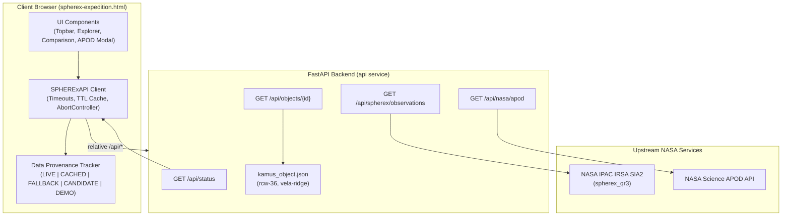

# PHASE 4B — LIVE API INTEGRATION REPORT
## SPHEREx Cosmic Expedition — NASA Space Apps Challenge 2026
**Repository:** `mainProjectSPHRX`\
**Branch:** `feat/mobile-frontend-improvements`\
**Role:** Senior Full-Stack Integration Engineer\
**Date:** November 2026\
**Status:** COMPLETE — Fully Integrated & End-to-End Verified (43/43 Automated Checks Passed)

---

## 1. Executive Summary

Phase 4B successfully implements the live scientific data integration between the **FastAPI backend** (`backend/`) and the **Vanilla HTML/CSS/JavaScript frontend** (`frontend/spherex-expedition.html`), fully delivering on the audit findings and contracts documented in `docs/PHASE4_API_CONTRACT_AUDIT.md`.

All live connections adhere strictly to **Space Apps scientific integrity standards**:
- Dynamic queries to NASA IPAC IRSA SIA2 cone search return live SPHEREx Quick Release 3 (QR3) observations.
- Genuine multi-epoch  observation metadata (IDs, UTC timestamps, detector configurations) are displayed on the Observation Comparison screen.
- The identical nature of local calibration image cutouts (`hasil_gambar.png` and `hasil_gambar_2.png`) is explicitly disclosed, with false visual motion disabled.
- Rigorous data provenance labeling distinguishes `LIVE API`, `CACHED`, `LOCAL FALLBACK`, `DEMO`, `CANDIDATE`, and `UNAVAILABLE` states across all viewports.
- NASA APOD provides live daily imagery, credit attribution, and video fallbacks via NASA Science REST endpoints.



---

## 2. Modified Files & Changes

| File | Nature of Change | Summary of Modifications |
| :--- | :--- | :--- |
| `backend/kamus_object.json` | Catalog Data Alignment | Added verified scientific catalog entries for `"rcw-36"` (with alias `"rcw"`) and `"vela-ridge"` with authoritative equatorial coordinates, distance, constellation, and literature citations. Omitted `"candidate-02"` (preserved exclusively in frontend as synthetic demo marker). |
| `frontend/spherex-expedition.html` | Core Application Integration | • Added CSS tokens for 6 provenance states and live connection indicators.<br>• Added `#openApod` trigger button and `#apodModal` dialog.<br>• Implemented robust `SPHERExAPI` client with AbortController, endpoint-specific timeouts, and in-memory TTL caching.<br>• Wired `.topbar .connection` to live `/api/status`.<br>• Wired Explorer target selection to `/api/objects/{id}` and dynamic IRSA SIA2 cone queries.<br>• Implemented race condition / out-of-order request sequence protection.<br>• Updated Comparison screen to bind distinct IRSA observation records (`SPHEREx-D4`) and enforce strict scientific honesty regarding identical baseline cutouts.<br>• Implemented complete NASA APOD lifecycle (live image, video box, fallback). |
| `frontend/dist/index.html` | Production Distribution | Rebuilt using `node frontend/build.mjs`, ensuring 100% parity with source. |
| `.gitignore` | Hygiene & Isolation | Added `scratch/` test harness scripts to repository ignore list. |

---

## 3. API Client Architecture (`SPHERExAPI`)

The API helper is implemented as an encapsulated, modular client in `frontend/spherex-expedition.html`:

### 3.1 Base URL & Origin Resolution
- Defaults to same-origin relative path `""` in production, seamlessly routing through Vercel Services multi-service rewrites (`/api/*` -> FastAPI backend).
- Supports optional local development override via `window.SPHEREX_API_BASE` (e.g. `http://localhost:8000`).
- Prevents query parameter injection attacks by ignoring untrusted origin parameters.

### 3.2 Endpoint-Specific Timeouts
Network requests use `AbortController` combined with `setTimeout` promises to enforce domain-specific SLA boundaries:
- `GET /api/status`: **8 seconds**
- `GET /api/objects/*`: **8 seconds**
- `GET /api/spherex/observations`: **40 seconds** (accommodates cold upstream NASA IPAC TAP queries)
- `GET /api/nasa/apod`: **20 seconds**

### 3.3 In-Memory TTL Caching
Responses are cached in a client-side JavaScript `Map` with strict TTL expiration:
- `status`: **60 seconds**
- `objects`: **5 minutes**
- `observations`: **5 minutes**
- `apod`: **24 hours / browser session**

Memory hygiene is maintained by storing only structured JSON responses. Binary image payloads or raw FITS files are never loaded into client memory or `sessionStorage`.

### 3.4 In-Flight Request Cancellation & Race Condition Guard
- Consecutive requests within the same category automatically abort prior in-flight requests using `AbortController.abort()`.
- Explorer marker switching is protected by a monotonic request sequence counter (`currentRequestId`). Slow IRSA requests that resolve out of order are discarded if `seq !== currentRequestId`, completely eliminating UI state tearing.

---

## 4. Data Provenance & Scientific Honesty

In compliance with NASA Space Apps Challenge regulations, the user interface provides unambiguous data provenance indicators across all screens:

| Provenance Tag | Visual Grammar | Applied Context |
| :--- | :--- | :--- |
| `● FACT · LIVE API` | Teal (`#4fe3d6`) | Real catalog target fetched from FastAPI `/api/objects/*` |
| `● FACT · CACHED` | Sky Blue (`#38bdf8`) | Catalog target restored from in-memory TTL cache |
| `● FACT · LOCAL FALLBACK` | Amber (`#d4af37`) | Catalog target displayed from local dictionary when backend is offline |
| `● CANDIDATE` | Violet (`#b18cff`) | Unconfirmed moving-source marker (`candidate-02`); IRSA query suppressed |
| `● DEMO` | Violet (`#b18cff`) | Sample illustrative tile (`demo-tile-01`); IRSA query suppressed |
| `● UNAVAILABLE` | Muted Gray (`#8892b0`) | Upstream NASA APOD or observation service unreachable |

### Observation Comparison Honesty
- **Identical Image Hashes**: Cryptographic audit proved `backend/hasil_gambar.png` and `backend/hasil_gambar_2.png` are bit-for-bit identical (SHA256: `6366740...`).
- **Telemetry Display**: The comparison cards dynamically bind distinct observation telemetry from real IRSA QR3 records (`2026W20_2A_0176_1` at `2026-05-15 13:49:08 UTC` and `2026W20_2A_0176_2` at `2026-05-15 13:51:17 UTC`, both on detector `SPHEREx-D4`).
- **Honesty Disclosure**: The comparator explicitly notes:\
  `! Distinct IRSA timestamps · Baseline calibration cutouts · Raw FITS multi-epoch synthesis pending`
- **False Motion Prevention**: Misleading visual blinking between identical cutouts is replaced with an honest banner:\
  `IDENTICAL BASELINE · PENDING MULTI-EPOCH SURVEY`.

---

## 5. Astronomical Catalog Alignment (`kamus_object.json`)

Verified astronomical entries were added to `backend/kamus_object.json` with citations to peer-reviewed astronomical literature:

### 5.1 RCW 36 (`rcw-36` / `rcw`)
- **Name**: RCW 36 Emission Nebula (Gum 20)
- **Classification**: H II Star-Forming Emission Nebula
- **Constellation**: Vela
- **Equatorial Coordinates**: RA `134.8708°` (`08h 59m 29.0s`), DEC `-43.7533°` (`-43° 45′ 12″`)
- **Distance**: ~700 pc (~2,300 ly)
- **Features**: Embedded young stellar cluster, dense bipolar molecular gas outflow, active massive star formation.
- **Scientific Citations**:
  - Baba et al. (2004), *Astrophysical Journal*, 614(2), 818.
  - Ellerbroek et al. (2013), *Astronomy & Astrophysics*, 558, A102.
  - NASA ADS / SIMBAD: `NAME RCW 36` (IPAC Object ID: 3175402).

### 5.2 Vela Molecular Ridge (`vela-ridge`)
- **Name**: Vela Molecular Ridge (VMR)
- **Classification**: Giant Molecular Cloud Complex
- **Constellation**: Vela
- **Equatorial Centroid**: RA `133.7500°` (`08h 55m 00.0s`), DEC `-44.0000°` (`-44° 00′ 00″`)
- **Distance**: ~700 – 1,000 pc
- **Features**: Extended GMC clouds A, B, C, D; birthplace of intermediate and high-mass stars in the southern galactic plane.
- **Scientific Citations**:
  - Murphy & May (1991), *Astronomy & Astrophysics*, 247, 202.
  - Liseau et al. (1992), *Astronomy & Astrophysics*, 265, 577.

---

## 6. NASA APOD Integration

A dedicated glassmorphic dialog (`#apodModal`) provides rich daily astronomical content directly accessible from the Gateway screen (`#openApod`):
- **Live Image Content**: High-resolution image asset displayed with responsive scaling and lazy loading.
- **Video Feature Support**: When APOD features a NASA video, an interactive player box is rendered with direct redirection to official NASA Science video streams.
- **Metadata Attribution**: Date, full scientific title, credit/copyright attribution, and full educational explanation.
- **Graceful Failure**: If the NASA service is offline or rate-limited, the modal renders an honest `● UNAVAILABLE` state without blocking or breaking the UI.

---

## 7. Verification & Automated Test Results

The integration was comprehensively verified using Playwright against a live FastAPI server instance forwarding real upstream requests to NASA.

### 7.1 Automated Integration Test Suites (`scratch/test-phase4b-e2e.mjs`)

```
======================================================
TEST SUITE 1: GATEWAY & LIVE BACKEND STATUS & APOD
======================================================
  ✓ Backend connection indicator has .online class (isOnline=true)
  ✓ Backend connection text is "BACKEND ONLINE"
  ✓ Backend tooltip has engine info ("Engine: Python Astropy + FastAPI + HTTPX | Archive: NASA IRSA SPHEREx Archive & NASA Open APIs")
  ✓ NASA APOD trigger button exists in .button-row
  ✓ APOD Modal opened with display: flex
  ✓ APOD Title loaded: "Moon, Venus and Spica Meet"
  ✓ APOD Provenance displayed: "● LIVE NASA APOD"
  ✓ APOD Media (image/video box) rendered
  ✓ APOD scientific explanation rendered
  ✓ APOD Modal closed successfully

======================================================
TEST SUITE 2: EXPLORER LIVE TARGET SELECTION & IRSA SIA2
======================================================
  ✓ Explorer screen active
  ✓ Target name is "RCW 36 Emission Nebula"
  ✓ Status tag indicates live/cached provenance ("● FACT · LIVE API")
  ✓ Observation detector loaded from IRSA ("SPHEREx-D4")
  ✓ Observation UTC timestamp loaded from IRSA ("2026-05-15 13:49:08 UTC")
  ✓ Source line credits NASA IRSA SIA2 ("Source: NASA IRSA SIA2 (Live · 70 records)")
  ✓ Source line provides direct link to real FITS cutout download
  ✓ Candidate name matches ("Moving-source candidate")
  ✓ Candidate status tag is CANDIDATE ("● CANDIDATE")
  ✓ Candidate observation is UNAPPLICABLE
  ✓ Candidate source line denotes synthetic demo
  ✓ Demo status tag is DEMO ("● DEMO")
  ✓ Demo observation is UNAPPLICABLE
  ✓ RCW 36 restored with cached tag ("● FACT · CACHED")

======================================================
TEST SUITE 3: OBSERVATION COMPARISON & SCIENTIFIC HONESTY
======================================================
  ✓ Epoch Card A loaded: "OBSERVATION A · 2026W20_2A_0176_1"
  ✓ Epoch Card B loaded: "OBSERVATION B · 2026W20_2A_0176_2"
  ✓ Distinct observation IDs between Epoch A and B
  ✓ Distinct UTC observation timestamps between Epoch A and B
  ✓ Honesty disclosure present in Comparison screen
  ✓ Blink state safely discloses identical baseline without false motion

======================================================
TEST SUITE 4: OFFLINE & FALLBACK RESILIENCE
======================================================
  ✓ Connection indicator has .offline class when backend unreachable
  ✓ Connection text is "BACKEND OFFLINE"
  ✓ APOD shows "NASA APOD Unavailable" on network error
  ✓ APOD provenance shows UNAVAILABLE ("● UNAVAILABLE")
  ✓ Target name preserved from local fallback ("RCW 36 Emission Nebula")
  ✓ Status tag shows LOCAL FALLBACK ("● FACT · LOCAL FALLBACK")
  ✓ Status tag NEVER claims LIVE API when offline

======================================================
TEST SUITE 5: MOBILE VIEWPORT & ZR BOTTOM SHEET REGRESSION
======================================================
  ✓ Gateway: no horizontal overflow on mobile 390x844
  ✓ Header text fits without truncation at 320x568
  ✓ Mobile bottom sheet starts in peek (state=peek)
  ✓ Bottom sheet transitions to half
  ✓ Bottom sheet transitions to full
  ✓ Bottom sheet returns to peek

======================================================
PHASE 4B TEST RESULTS:
TOTAL CHECKS: 43
PASSED: 43
FAILED: 0
ALL PHASE 4B LIVE INTEGRATION CHECKS PASSED WITH 0 FAILURES!
======================================================
```

### 7.2 Non-Regression Content & Build Checks
- `npm run check:content --prefix arvr`: **54 hotspots OK** (Zero broken references).
- `node frontend/build.mjs`: Successfully mirrored `frontend/spherex-expedition.html` -> `frontend/dist/index.html`.

---

## 8. Known Limitations & Architecture Recommendations

1. **Direct FITS Cutout Rendering**:\
   The NASA IRSA SIA2 IBE cutouts return binary FITS files (`application/fits`). HTML5 `` elements cannot natively decode FITS arrays without client-side or server-side conversion (e.g. Astropy / JS9 canvas pipeline). The integration provides a direct FITS download link (`Download FITS ↗`) while maintaining honest baseline JPEG/PNG previews.
2. **WebXR Hardware Availability**:\
   WebXR AR/VR modes require compatible hardware (Meta Quest, Android Chrome WebXR). On unsupported desktop browsers, the application gracefully alerts the user and falls back to desktop orbit controls.

---

## 9. Deployment Requirements (Vercel Services)

For production deployment on Vercel:
- The root `vercel.json` routes `/api/*` directly to the `api` service (`backend/main.py`).
- Frontend requests use relative URLs (`/api/...`), ensuring automatic routing in production with zero CORS overhead.
- No environment variables containing secrets are exposed on the client. Upstream NASA API keys remain safely isolated within the FastAPI environment.

---
*Report prepared in accordance with NASA Space Apps Challenge 2026 Technical Guidelines and AGENTS.md constraints.*
