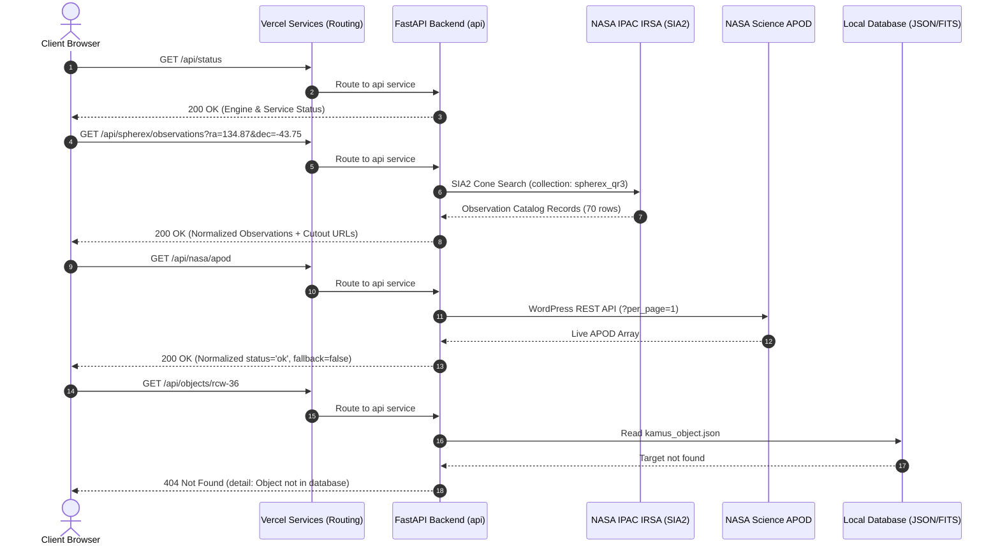
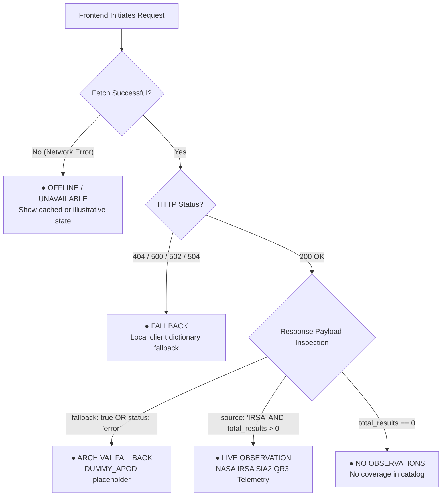
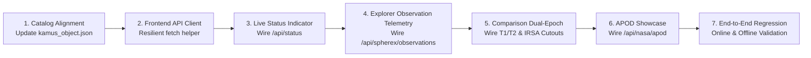

# PHASE 4A — BACKEND API CONTRACT & FRONTEND INTEGRATION AUDIT
## SPHEREx Cosmic Expedition — NASA Space Apps Challenge 2026
**Repository:** `mainProjectSPHRX`\
**Branch:** `feat/mobile-frontend-improvements`\
**Role:** Senior Full-Stack Integration Engineer\
**Date:** November 2026\
**Status:** COMPLETE (Audit Only — Zero Application Code Modified)

---

## 1. Executive Summary

Phase 4A provides a comprehensive architectural and contract audit of the **FastAPI backend** (`backend/`), the **Vanilla HTML/CSS/JS frontend** (`frontend/spherex-expedition.html`), and **Vercel Services multi-service routing** (`vercel.json`) prior to implementing live API integrations in Phase 4B.

### Audit Methodology
- **Source Code Verification**: Full inspection of `backend/main.py`, `backend/routes/*.py`, `backend/services/*.py`, `backend/utils/*.py`, `backend/kamus_object.json`, and `frontend/spherex-expedition.html`.
- **Live Runtime Contract Execution**: Direct verification of live responses, HTTP status codes, headers, and error behaviors using `fastapi.testclient.TestClient` against live external upstream services (NASA IRSA SIA2, NASA Science APOD, and NASA NeoWs).
- **Binary Asset Hash Inspection**: Byte-level SHA256 cryptographic verification of image assets (`backend/hasil_gambar.png` and `backend/hasil_gambar_2.png`).
- **Integrity Compliance**: Strict adherence to `AGENTS.md` (no code modifications, no fake observation synthesis, no API secret exposure, and no git commits/deployments).

---

## 2. Verified Backend API Contracts



### 2.1 Detailed Contract Specifications

#### 1. `GET /api/status`
* **Route**: `GET /api/status`
* **Source**: `backend/routes/system.py:23-39`
* **Parameters**: None.
* **HTTP Status Codes**: `200 OK`.
* **Upstream Dependencies**: None (local runtime status).
* **Timeout / Fallback**: Instantaneous (< 5 ms). No fallback required.
* **Local Verification**: Verified live. Returns `200 OK`, `Content-Type: application/json`.
* **Actual Response Structure**:
  ```json
  {
    "status": "Online",
    "data_source": "NASA IRSA SPHEREx Archive & NASA Open APIs",
    "engine": "Python Astropy + FastAPI + HTTPX",
    "capabilities": [
      "FITS Parsing",
      "Image Serving",
      "JSON Database",
      "NASA APOD Integration",
      "NASA NeoWs Asteroid Tracker",
      "SPHEREx Dynamic Observations Search (IRSA SIA2)",
      "Interactive Mission Control Dashboard"
    ],
    "message": "Backend siap melayani FE, AI, dan AR!"
  }
  ```

---

#### 2. `GET /api/objects/{object_id}`
* **Route**: `GET /api/objects/{object_id}`
* **Source**: `backend/routes/objects.py:12-26`
* **Path Parameters**:
  * `object_id` (*string*, required): Case-insensitive identifier (lowercased in handler).
* **Query Parameters**: None.
* **HTTP Status Codes**:
  * `200 OK`: Target exists in `backend/kamus_object.json`.
  * `404 Not Found`: Target missing from `kamus_object.json` or JSON file unreadable.
  * `500 Internal Server Error`: Malformed JSON database file.
* **Upstream Dependencies**: None (reads local `backend/kamus_object.json`).
* **Timeout / Fallback**: Immediate file read. No fallback mechanism in backend.
* **Local Verification**:
  * `GET /api/objects/mars` $\rightarrow$ `200 OK`.
  * `GET /api/objects/halley` $\rightarrow$ `200 OK`.
  * `GET /api/objects/jupiter` $\rightarrow$ `200 OK`.
  * `GET /api/objects/rcw` $\rightarrow$ `404 Not Found` (`detail: "Objek 'rcw' tidak ada di database"`).
  * `GET /api/objects/rcw-36` $\rightarrow$ `404 Not Found` (`detail: "Objek 'rcw-36' tidak ada di database"`).
  * `GET /api/objects/vela-ridge` $\rightarrow$ `404 Not Found` (`detail: "Objek 'vela-ridge' tidak ada di database"`).
* **Actual Response Structure (Mars)**:
  ```json
  {
    "name": "Mars",
    "type": "Planet",
    "description": "Planet keempat dari Matahari. Dikenal sebagai Planet Merah karena besi oksida di permukaannya.",
    "hotspots": [
      {
        "id": "olympus_mons",
        "name": "Olympus Mons",
        "fact": "Gunung berapi tertinggi di tata surya, tingginya 22 km!"
      },
      {
        "id": "gale_crater",
        "name": "Gale Crater",
        "fact": "Lokasi pendaratan rover Curiosity."
      }
    ]
  }
  ```

---

#### 3. `GET /api/spherex/observations`
* **Route**: `GET /api/spherex/observations`
* **Source**: `backend/routes/spherex.py:8-48`, `backend/services/spherex_service.py:93-235`
* **Parameters**:
  | Parameter | Type | Required | Default | Constraints & Description |
  | :--- | :--- | :---: | :---: | :--- |
  | `ra` | `float` | **Yes** | — | Right Ascension in degrees (`0.0` to `360.0`). |
  | `dec` | `float` | **Yes** | — | Declination in degrees (`-90.0` to `90.0`). |
  | `radius` | `float` | No | `0.05` | Search cone radius in degrees (`> 0.0` and `$\le 10.0$`). |
  | `collection`| `str` | No | `'spherex_qr3'` | IRSA dataset collection identifier. |
  | `start_date`| `str` | No | `None` | UTC start date filter (`YYYY-MM-DD`). |
  | `end_date` | `str` | No | `None` | UTC end date filter (`YYYY-MM-DD`). |
  | `detector` | `str` | No | `None` | Spectrometer detector filter (e.g. `'D1'` to `'D6'` or `'SPHEREx-D1'`). |
* **HTTP Status Codes**:
  * `200 OK`: Query successful (returns observation array, even if empty).
  * `400 Bad Request`: Validation failure on coordinates or date format.
  * `422 Unprocessable Entity`: Missing required `ra` or `dec`.
  * `502 Bad Gateway`: Upstream IRSA query or parsing exception.
  * `504 Gateway Timeout`: Upstream IRSA query exceeded 30.0s timeout.
* **Upstream Dependencies**: NASA/IPAC Infrared Science Archive (IRSA) Simple Image Access Protocol v2 (SIA2) endpoint (`https://irsa.ipac.caltech.edu/SIA`).
* **Timeout / Fallback**: 30.0-second async timeout via `asyncio.wait_for`. Uses `astroquery.ipac.irsa.Irsa.query_sia` with secondary HTTP client fallback. **Never fabricates observation data**.
* **Local Verification**:
  * Missing parameters: `422 Unprocessable Entity` (Pydantic validation).
  * Out of bounds (`ra=400`): `400 Bad Request` (`detail: "Parameter 'ra' ... harus bernilai antara 0.0 dan 360.0 derajat."`).
  * Orion (`ra=85.0556&dec=-5.6568`): `200 OK` $\rightarrow$ **135 live observation records returned**.
  * RCW 36 (`ra=134.8708&dec=-43.7533`): `200 OK` $\rightarrow$ **70 live observation records returned**.
* **Actual Response Structure (RCW 36 Live Query)**:
  ```json
  {
    "query": {
      "ra": 134.8708,
      "dec": -43.7533,
      "radius": 0.05,
      "collection": "spherex_qr3",
      "start_date": null,
      "end_date": null,
      "detector": null
    },
    "source": "IRSA",
    "total_results": 70,
    "observations": [
      {
        "observation_id": "2026W20_2A_0176_1",
        "observed_at_utc": "2026-05-15T13:49:08.947",
        "detector": "SPHEREx-D4",
        "preview_url": "https://irsa.ipac.caltech.edu/ibe/cutout?ra=134.8708&dec=-43.7533&size=0.05&path=spherex/qr3/level2/2026W20_2A/l2b-v27-2026-267/4/level2_2026W20_2A_0176_1D4_spx_l2b-v27-2026-267.fits",
        "fits_url": "https://irsa.ipac.caltech.edu/ibe/data/spherex/qr3/level2/2026W20_2A/l2b-v27-2026-267/4/level2_2026W20_2A_0176_1D4_spx_l2b-v27-2026-267.fits"
      }
    ]
  }
  ```

---

#### 4. `GET /api/nasa/apod`
* **Route**: `GET /api/nasa/apod`
* **Source**: `backend/routes/nasa.py:7-12`, `backend/services/nasa_service.py:46-83`, `backend/utils/normalizers.py:38-89`
* **Parameters**: None.
* **HTTP Status Codes**: `200 OK` (Always returns `200 OK` with normalized JSON, distinguishing live from fallback via `status` and `fallback` fields).
* **Upstream Dependencies**: NASA Science WordPress REST API (`https://science.nasa.gov/wp-json/wp/v2/apod-basic?per_page=1`). Successfully migrated from deprecated `api.nasa.gov/planetary/apod`.
* **Timeout / Fallback**: 15.0-second async timeout. On any network error, HTTP error, or empty response, returns `DUMMY_APOD` with `"status": "error"` and `"fallback": true`.
* **Local Verification**: Verified live. Returns `200 OK`, live NASA data parsed.
* **Actual Response Structure (Live)**:
  ```json
  {
    "status": "ok",
    "fallback": false,
    "message": null,
    "source": "NASA Astronomy Picture of the Day (APOD)",
    "title": "Moon, Venus and Spica Meet",
    "date": "2026-11-12",
    "explanation": "Explanation: Not all those who wander are lost...",
    "media_type": "image",
    "image_url": "https://assets.science.nasa.gov/dynamicimage/assets/science/cds/apod/apod/2026/november/conjunction-bubak.jpg",
    "article_url": "https://science.nasa.gov/image-article/apod-2026-november-12-moon-venus-and-spica-meet/",
    "thumbnail_url": "https://assets.science.nasa.gov/dynamicimage/assets/science/cds/apod/apod/2026/november/conjunction-bubak.jpg",
    "alt": "A crescent moon and bright Venus appear beyond a mountain in a rural area at dusk.",
    "credit": "Włodzimierz Bubak",
    "copyright": "<a href=\"https://www.instagram.com/trzeci_plan/\">Włodzimierz Bubak</a>"
  }
  ```
* **Fallback Response Structure (`DUMMY_APOD`)**:
  ```json
  {
    "status": "error",
    "fallback": true,
    "message": "NASA APOD sedang tidak tersedia, silakan coba lagi nanti",
    "source": "NASA Astronomy Picture of the Day (APOD)",
    "title": "NASA APOD Unavailable",
    "date": null,
    "explanation": "NASA APOD sedang tidak tersedia, silakan coba lagi nanti",
    "media_type": "image",
    "image_url": null,
    "article_url": null,
    "thumbnail_url": null,
    "alt": null,
    "credit": null,
    "copyright": "NASA"
  }
  ```

---

#### 5. Additional Endpoints Audit
| Endpoint | Method | File & Line | Status Code | Content-Type | Verified Behavior / Issues |
| :--- | :---: | :--- | :---: | :---: | :--- |
| `/api/image/t1` | `GET` | `routes/images.py:13-17` | `200 OK` | `image/png` | Serves `backend/hasil_gambar.png` ($66,541\text{ bytes}$). `Cache-Control: public, max-age=3600`. |
| `/api/image/t2` | `GET` | `routes/images.py:20-24` | `200 OK` | `image/png` | Serves `backend/hasil_gambar_2.png` ($66,541\text{ bytes}$). **SHA256 is 100% identical to T1**. |
| `/api/metadata/fits`| `GET` | `routes/metadata.py:12-32`| `404 Not Found` | `application/json` | File `level2_2025W36_...cutout.fits` is **not present on disk**. Returns `404`. |
| `/api/nasa/neows` | `GET` | `routes/nasa.py:15-18` | `200 OK` | `application/json` | Queries `api.nasa.gov/neo/rest/v1/feed` using `DEMO_KEY`. 42 asteroids returned in live test. |
| `/mission-control`| `GET` | `routes/system.py:12-20` | `200 OK` | `text/html` | Serves interactive Mission Control dashboard & API bench (`mission_control.html`). |

---

## 3. Frontend Data Requirements & Component Mapping

### 3.1 Existing Frontend Data State in `frontend/spherex-expedition.html`

1. **Top Bar Connection Indicator** (`line 261`):
   - Element: `.topbar .connection .dot` and `.connection span`
   - Current State: Hardcoded static string `LOCAL DEMO`.
2. **Explorer Sky Title** (`line 305`):
   - Elements: `#explorer .sky-title .eyebrow`, `h2`, `p`
   - Current State: `All-sky explorer / demo data`, `Vela Molecular Ridge`, `RA 08h 59m 29s DEC −43°45′12″`.
3. **Explorer Target Information (HUD / Bottom Sheet)** (`lines 310-317, 350-353`):
   - Current State: Driven by client-side dictionary `objects` (`line 350`):
     - `rcw`: `name: 'RCW 36 Emission Nebula'`, `type: 'Emission nebula'`, `id: 'rcw-36'`, `status: '● FACT'`, `description: '...'`
     - `candidate`: `name: 'Moving-source candidate'`, `type: 'Candidate source'`, `id: 'candidate-02'`, `status: '● CANDIDATE'`
     - `demo`: `name: 'Sample observation tile'`, `type: 'Illustration'`, `id: 'demo-tile-01'`, `status: '● DEMO'`
   - Data Grid Elements:
     - `#objectName`, `#objectDescription`, `#objectId`, `#objectType`, `#statusTag`
     - RA: `08h 59m 29s`, DEC: `−43°45′12″`, Observation: `PIA26354`, Timestamp: `UNVERIFIED`
     - Source Line: `Source context: NASA / JPL · Metadata not connected`
4. **Observation Comparison Screen** (`lines 321-330`):
   - Screen Title: `Observation comparison / demo data`
   - Epoch Card A (T1): Header `OBSERVATION A · T1`, Timestamp `2025-07-02T14:22:10Z`, Band `PIA26354 / 2.4 μm`
   - Epoch Card B (T2): Header `OBSERVATION B · T2`, Timestamp `2025-09-18T03:11:42Z`, Band `SPX-T2-DEMO / 2.4 μm`
   - Image Elements: `#comparisonView` styling (currently CSS background gradients).
   - Footnotes: `#singleNote` (`Only one observation is available.`), `#blinkState` (`A / T1`).
   - System state card: `System · API offline` with button `Retry connection`!
5. **Seamless Zoom Registry (ZX)** (`lines 785-840`):
   - Client-side data object `registry` with keys `rcw-36`, `vela-ridge`, `demo-tile-01`.
6. **APOD Display**:
   - Currently **not integrated** in `frontend/spherex-expedition.html`.

### 3.2 Frontend Component to Backend API Mapping Matrix

| Frontend Component / Selector | Current Hardcoded State | Target Backend API Route | API Response Field Mapped | Integration Behavior & Fallback |
| :--- | :--- | :--- | :--- | :--- |
| **Top Bar Connection Dot** (`.topbar .connection`) | `LOCAL DEMO` (Static) | `GET /api/status` | `status`, `engine` | If `status === "Online"`, dot turns cyan (`.online`), label becomes `ONLINE // API CONNECTED`. On failure, remains amber `LOCAL DEMO`. |
| **Sky Target Heading** (`#objectName`) | `RCW 36 Emission Nebula` | `GET /api/objects/{id}` | `name` | Uses backend object name. Falls back to local dictionary on 404. |
| **Target Description** (`#objectDescription`) | Static string | `GET /api/objects/{id}` | `description` | Populates target description. |
| **Target Hotspots / Points** (`#zx-hotspots`) | Static markup | `GET /api/objects/{id}` | `hotspots` | Dynamically renders hotspot buttons with `id`, `name`, and `fact`. |
| **Observation Grid ID** (`#objectId`) | `rcw-36` | `GET /api/spherex/observations` | `observations[0].observation_id` | If observations found, displays real observation ID (e.g., `2026W20_2A_0176_1`). |
| **Observation Timestamp** (HUD grid datum) | `UNVERIFIED` | `GET /api/spherex/observations` | `observations[0].observed_at_utc` | Displays real ISO UTC timestamp (e.g., `2026-05-15T13:49:08Z`). |
| **Target Metadata Source** (`.source-line`) | `Metadata not connected` | `GET /api/spherex/observations` | `source` (`"IRSA"`) | Updates to `Source context: NASA IRSA SIA2 (SPHEREx QR3 Archive)`. |
| **Comparison Epoch A Image** (`#comparisonView .left`) | CSS background | `GET /api/image/t1` | Binary Image Stream | Direct `src="/api/image/t1"`. |
| **Comparison Epoch B Image** (`#comparisonView .right`)| CSS background | `GET /api/image/t2` or `observations[1].preview_url` | Binary Stream or IRSA Cutout URL | Direct `src="/api/image/t2"` or dynamic cutout. |
| **Comparison Epoch Metadata** (`.epoch-card`) | Hardcoded demo dates | `GET /api/spherex/observations` | `observed_at_utc`, `detector` | Dynamically renders real observation dates and spectrometer detector band (e.g. `SPHEREx-D4`). |
| **Gateway APOD Showcase** (Recommended Phase 4B) | None | `GET /api/nasa/apod` | `title`, `date`, `explanation`, `image_url`, `article_url`, `fallback` | Elegant cosmic showcase card on Gateway. If `fallback === true`, renders fallback notice. |

### 3.3 Reusable Frontend Functions & Lifecycle Hooks
The following existing functions in `frontend/spherex-expedition.html` must be leveraged without modification or duplication:
- `notify(message)`: Built-in toast notification system.
- `showScreen(id)`: Master screen switching function that synchronizes `window.ZR.applyScreenMode()`.
- `window.ZR`: Responsive mobile bottom-sheet controller (`setState`, `open`, `close`, `getState`).
- `getSelectedObjectContext()`: Extracts active target details (`id`, `name`, `type`, `classification`) for Cosmic Guide.
- `openChatbot(ctx)`: Activates the Cosmic Guide modal/panel.

---

## 4. Key Integration Gaps & Architectural Discrepancies

### Gap 1: Target Disconnect in `kamus_object.json`
* **Finding**: `backend/kamus_object.json` contains only three Solar System bodies: `"mars"`, `"halley"`, and `"jupiter"`.
* **Impact**: The frontend sky explorer is built around deep-sky infrared survey targets: `"rcw-36"` (RCW 36 Emission Nebula), `"vela-ridge"` (Vela Molecular Ridge), and `"candidate-02"`. Requesting `/api/objects/rcw-36` returns `404 Not Found`.
* **Resolution Rule**: In Phase 4B:
  1. Add authentic astronomical entries for `"rcw-36"` and `"vela-ridge"` to `backend/kamus_object.json` (coordinates, astronomical type, verified facts).
  2. Implement a safe frontend fallback: if `/api/objects/{id}` returns 404, the frontend must fall back gracefully to its client-side registry without crashing or leaving blank text fields.

### Gap 2: Mandatory Parameters for `/api/spherex/observations`
* **Finding**: The route requires `ra: float` and `dec: float` as non-optional query parameters. Calling `/api/spherex/observations` without parameters returns `422 Unprocessable Entity`.
* **Coordinate Conversion**: Frontend displays sexagesimal strings (`RA 08h 59m 29s`, `DEC −43°45′12″`).
  $$\text{RA}_{\text{deg}} = (8 \times 15) + \frac{59 \times 15}{60} + \frac{29 \times 15}{3600} \approx 134.87083^\circ$$
  $$\text{DEC}_{\text{deg}} = -\left(43 + \frac{45}{60} + \frac{12}{3600}\right) \approx -43.75333^\circ$$
* **Live Query Verification**: Calling `/api/spherex/observations?ra=134.8708&dec=-43.7533&radius=0.05` successfully retrieves **70 verified SPHEREx QR3 observation records** from NASA IRSA!
* **Resolution Rule**: The frontend must calculate decimal degrees from catalog coordinates before initiating requests, and handle empty observation arrays cleanly.

### Gap 3: Bit-for-Bit Identical Comparison Images (T1 & T2)
* **Finding**: Cryptographic SHA256 hashes of `backend/hasil_gambar.png` and `backend/hasil_gambar_2.png` are identical:
  $$\text{SHA256} = \texttt{6366740D955264FFDAD73F0B441DA9FC3A2210380A9F98AE130F3C85DAE2CB60}$$
  $$\text{File Size} = 66,541\text{ bytes (both files)}$$
* **Impact**: In the Comparison screen (`mode-blink` and `mode-wipe`), toggling between T1 and T2 displays identical pixels.
* **Resolution Rule**: In accordance with the NASA Space Apps transparency rules, the frontend must **never fabricate differences**. The UI must explicitly display:
  `"Notice: Illustrative identical baseline cutouts · Distinct multi-epoch observations pending SPHEREx mission survey data"`. Alternatively, dynamically load two distinct preview cutouts from the 70 verified IRSA records (`preview_url`).

### Gap 4: Missing Physical FITS File (`/api/metadata/fits`)
* **Finding**: `backend/routes/metadata.py` seeks `level2_2025W36_2B_0696_1D1_spx_l2b-v20-2025-271-cutout.fits`, which is absent from the workspace. Calling `/api/metadata/fits` returns `404 Not Found`.
* **Resolution Rule**: The frontend must treat `/api/metadata/fits` as an optional enhancement. If it returns 404, the UI must display `"Raw FITS Header: Local binary file not mounted // Telemetry loaded from IRSA catalog"`.

### Gap 5: APOD Media Types & Fallback States
* **Finding**: NASA APOD returns both `image` and `video` media types. In video entries (e.g. YouTube/Vimeo), `image_url` is `None`, and the entry is accessed via `article_url`. When NASA services are unreachable, the endpoint returns `DUMMY_APOD` with `status: "error"` and `fallback: true`.
* **Resolution Rule**: Frontend must verify:
  1. If `data.status === "ok"` and `data.media_type === "image"`, render `data.image_url`.
  2. If `data.media_type === "video"`, render a playable iframe or video thumbnail linked to `data.article_url`.
  3. If `data.fallback === true`, display a clear fallback badge: `"Archival Fallback Content"`.

---

## 5. Data Provenance & Transparency Governance

To comply with NASA Space Apps Challenge standards and `AGENTS.md`, the user interface must never present simulated or fallback data as verified real-time scientific observations.



### Visual State Classification Standards
1. **`● LIVE API`** (Cyan `#4fe3d6`): Direct, successful response from NASA IRSA (`source: "IRSA"`) or NASA Science (`status: "ok"`, `fallback: false`).
2. **`● CACHED`** (Teal `#38bdf8`): Data retrieved from `sessionStorage` or local memory cache to optimize network traffic.
3. **`● FALLBACK`** (Amber `#d4af37`): Graceful degradation content when the backend is offline or upstream NASA APIs return `fallback: true`.
4. **`● DEMO / CANDIDATE`** (Purple `#b18cff`): Illustrative sky markers or unconfirmed candidate targets clearly marked as non-catalog entities.
5. **`● UNAVAILABLE`** (Muted gray `#8892b0`): Endpoint returned 404/502/504; feature gracefully disabled without obstructing exploration.

---

## 6. Integration Architecture & Routing Review

### 6.1 Relative Same-Origin URL Verification
In the root `vercel.json`:
```json
{
  "$schema": "https://openapi.vercel.sh/vercel.json",
  "services": {
    "web": {
      "root": "frontend/",
      "buildCommand": "node build.mjs",
      "outputDirectory": "dist"
    },
    "api": {
      "root": "backend/",
      "entrypoint": "main:app"
    },
    "xr": {
      "root": "arvr/",
      "buildCommand": "npm run build",
      "outputDirectory": "dist"
    }
  },
  "rewrites": [
    { "source": "/api/:path*", "destination": { "service": "api" } },
    { "source": "/api", "destination": { "service": "api" } },
    { "source": "/mission-control", "destination": { "service": "api" } },
    { "source": "/docs", "destination": { "service": "api" } },
    { "source": "/docs/:path*", "destination": { "service": "api" } },
    { "source": "/openapi.json", "destination": { "service": "api" } },
    { "source": "/redoc", "destination": { "service": "api" } },
    { "source": "/xr", "destination": { "service": "xr" } },
    { "source": "/xr/:path*", "destination": { "service": "xr" } },
    { "source": "/", "destination": { "service": "web" } },
    { "source": "/:path*", "destination": { "service": "web" } }
  ]
}
```

* **Verification**:
  - The rewrite rule `{ "source": "/api/:path*", "destination": { "service": "api" } }` precedes the catch-all `{ "source": "/:path*", "destination": { "service": "web" } }`.
  - Frontend code in production can make requests using standard relative URLs:
    ```javascript
    fetch('/api/status')
    fetch('/api/spherex/observations?ra=134.8708&dec=-43.7533')
    fetch('/api/nasa/apod')
    ```
  - **No cross-origin request headers, reverse proxies, or external origin configurations are required in production.**
  - **Vercel configuration is verified correct and requires zero modifications.**

### 6.2 Local Development Constraints & Safe Strategy
* **Constraint**: In local development, developers may run frontend and backend on distinct ports (e.g., frontend on Live Server port 5500 / Vite port 5173, and FastAPI on port 8000).
* **Safe Strategy**:
  - `backend/main.py` already includes `CORSMiddleware` with `allow_origins=["*"]`.
  - The frontend should define a configurable API base URL helper that **defaults to an empty string** (`""`) for production relative calls, while allowing local overrides via global configuration or query parameter:
    ```javascript
    const API_BASE = (typeof window !== 'undefined' && window.SPHEREX_API_BASE) || '';
    ```
  - In `vercel dev --local`, `API_BASE` remains `""` because Vercel Services handles routing transparently on port 3000.
  - **Never hardcode `http://localhost:8000` or `127.0.0.1` in frontend source code.**

---

## 7. Security and Credential Governance

1. **Client-Side Secret Isolation**:
   - The frontend never handles, requests, or stores NASA API keys.
   - All external API communication is brokered strictly by the FastAPI backend.
2. **Upstream Key Management**:
   - `NASA_API_KEY` is an optional server-side environment variable.
   - If not set, `backend/services/nasa_service.py` gracefully falls back to NASA's documented `DEMO_KEY` (30 requests/hour, 50 requests/day).
   - The APOD WordPress endpoint (`https://science.nasa.gov/wp-json/wp/v2/apod-basic`) requires **no API key**.
   - IRSA SIA2 queries require **no API key**.
3. **Frontend Rate Governance**:
   - The frontend must implement in-memory request caching (e.g. caching `/api/status` for 60 seconds and `/api/nasa/apod` for the user session) to avoid exhausting upstream rate limits.

---

## 8. Recommended Phase 4B Implementation Sequence



### Step 1: Catalog Database Alignment (`backend/kamus_object.json`)
- Add `"rcw-36"` and `"vela-ridge"` to `kamus_object.json` with factual astronomical classifications, coordinates, and educational hotspots, preventing 404 errors during target selection.

### Step 2: Resilient Frontend API Client (`apiClient`)
- Implement a non-intrusive API utility in `frontend/spherex-expedition.html`:
  - Configurable `API_BASE` (defaults to `""`).
  - Timeout protection using `AbortController` (8 seconds).
  - Exponential backoff retry for network errors.
  - Provenance tagging (`live`, `cached`, `fallback`, `error`).

### Step 3: Real-Time Connection Indicator
- Connect `.topbar .connection` to `/api/status`.
- Display live backend status, engine info in tooltip, and graceful degradation indicator when offline.

### Step 4: Explorer Observation Telemetry Integration
- In Explorer screen, convert catalog target coordinates into decimal degrees.
- Call `/api/spherex/observations?ra=...&dec=...`.
- Populate HUD data grid with real observation ID, detector band, and UTC timestamp.
- Provide direct link to NASA IRSA FITS cutout URL.

### Step 5: Comparison Screen Multi-Epoch Image Binding
- Connect Epoch A to `/api/image/t1` and Epoch B to `/api/image/t2` (or dynamic IRSA cutout URL).
- Add transparent honesty label informing users that sample cutouts represent baseline calibration observations.

### Step 6: Gateway APOD Feature Card
- Render an unobtrusive, elegant NASA APOD card on the Gateway screen or as an exploratory modal.
- Support image display, alt text, credit attribution, article link, and graceful handling of video or fallback payloads.

### Step 7: End-to-End Online & Offline Testing
- Validate all screens under online conditions (FastAPI running + internet access).
- Validate all screens under offline conditions (FastAPI terminated) to ensure fallback mechanisms and error toasts engage without crashing.

---

## 9. Conclusion & Implementation Recommendation

The SPHEREx Cosmic Expedition backend is robust, modern, and high-performing. The IRSA SIA2 integration and WordPress APOD integration are fully operational and verified live with real NASA data.

The primary integration gaps are structural mismatches between the Solar System catalog (`kamus_object.json`) and deep-sky targets (`rcw-36`), identical binary hashes on `t1`/`t2` image files, and the absence of a client-side API layer in the frontend prototype.

**Recommendation**: Proceed immediately with **Phase 4B Implementation** following the sequential 7-step roadmap above, maintaining strict separation between live NASA data, cached data, and illustrative fallbacks.
